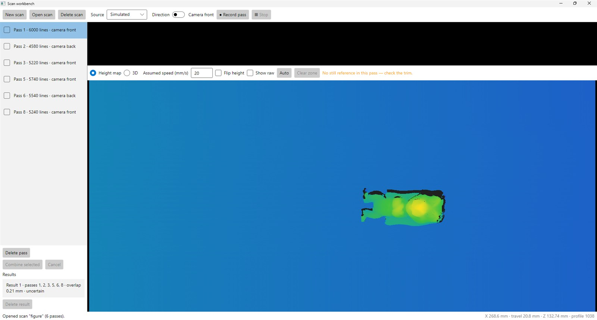
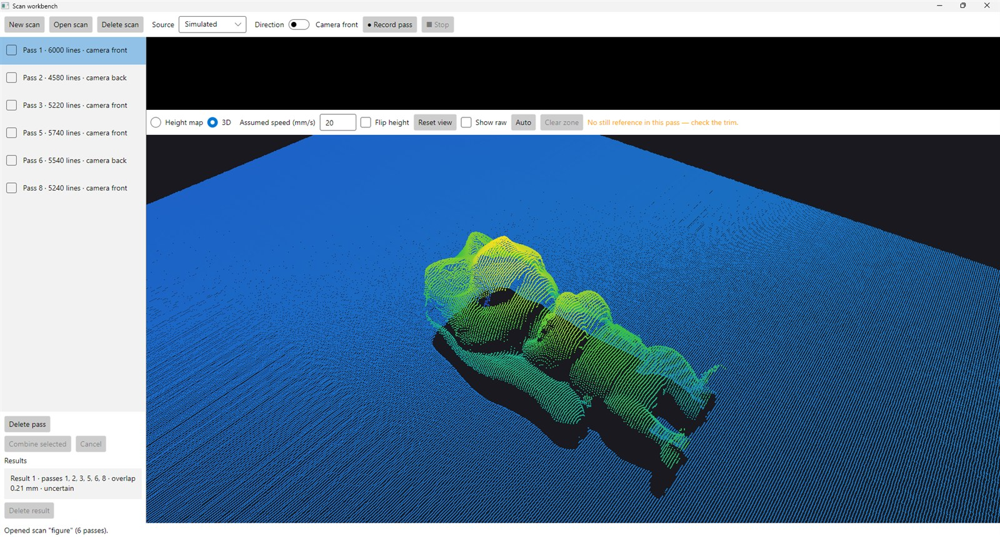
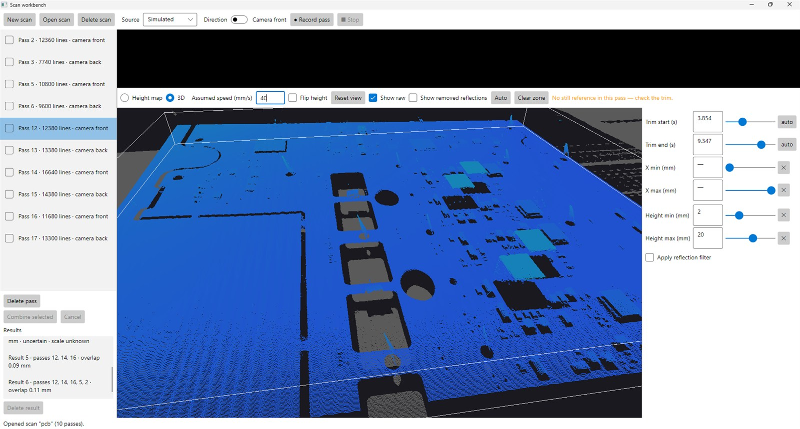
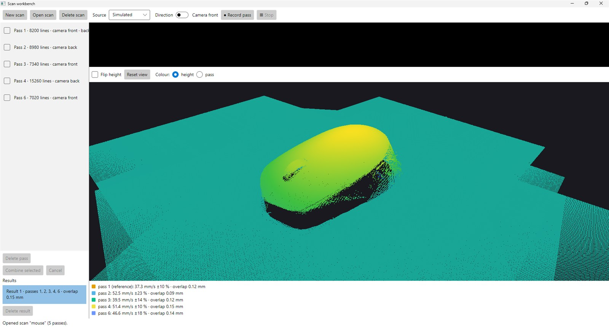
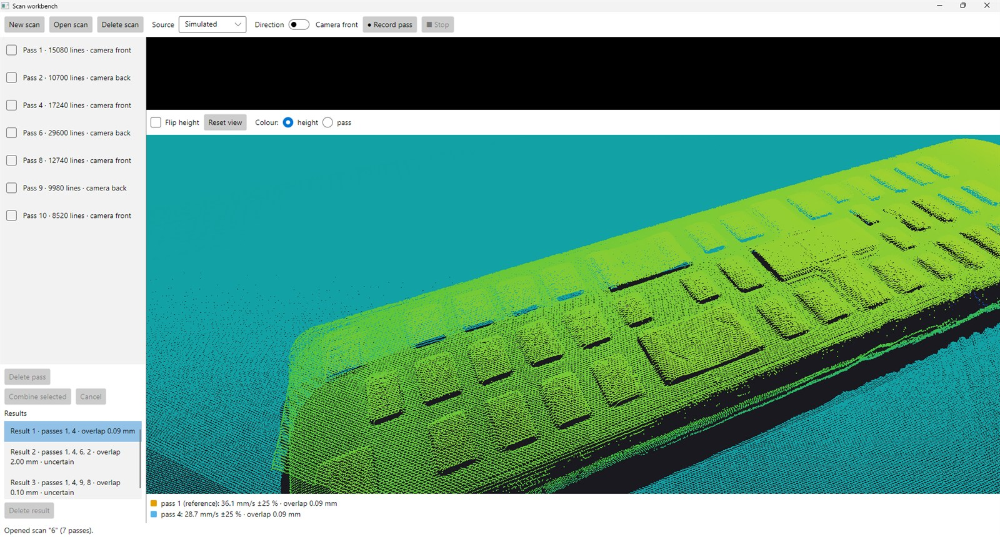
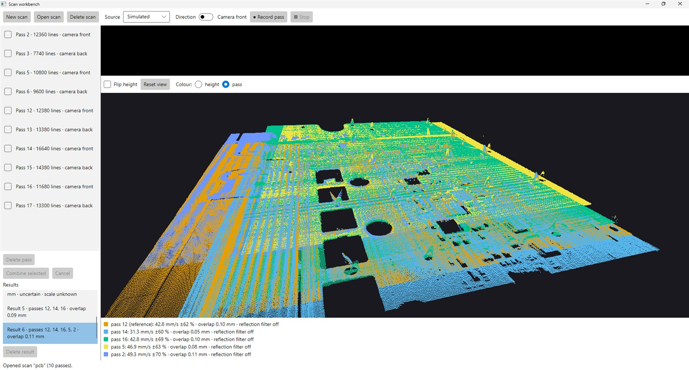

# Hand-driven laser scan workbench

An exploratory desktop workbench for a **SICK Ruler3020** (Ruler3000 family) laser profile scanner that is **pushed by hand along a rail, with no encoder**. It records passes over an object, lets you inspect and clean each pass, and combines several passes into one 3D point cloud by estimating how fast and in what pose each pass was taken.

> **Status: archived (November 2026).** This is a research record, not a maintained tool. The conclusion: without an encoder, the travel axis of a hand-pushed pass can be estimated well enough to get recognisable, often good-looking models, but not reliably accurate ones. See [Limitations](#limitations).

## What it looks like

A single pass of a small figure, as a height map (top view, blue low, yellow high) and as a 3D point cloud:




Cleaning up a pass in the raw view: here the trims and a height band (2–20 mm above the table) are set in the panel on the right; the points they cut away are drawn grey, and the box shows the kept region. The orange hint says the automatic trim found no still moment in this pass, so the trims were set by hand.



**Combines that worked.** A computer mouse from five passes, and a game controller from two. Below each result, one line per pass gives its estimated speed, the speed's variation, and how far it disagrees with the others (overlap, median absolute height difference).




**A combine that did not work.** A PCB from five passes, coloured by pass. The middle of the board lines up, and the per-pass overlap numbers look fine (0.05–0.11 mm), but along the left edge the passes sit side by side instead of on top of each other, and the hole and component outlines are smeared. The speeds vary by ±60–70 % within each pass: the travel axis is not pinned down.



## Requirements

- **Windows x64.** The bundled SICK SDK is Windows x64 only.
- **.NET SDK 10.0.100** or a later feature band (pinned in [`global.json`](global.json)).
- **A GPU with desktop OpenGL 3.3** for the 3D view. Without it (basic display adapter, VM, remote desktop) the app still starts; only the 3D view is lost.
- **For real scanning:**
  - a SICK Ruler3000-family scanner on a GigE (Ethernet) port of the PC;
  - the **Microsoft Visual C++ Redistributable for Visual Studio 2013 (x64) and 2015–2022 (x64)**, which SICK's native libraries need. Many PCs already have both; a PC with SICK Stream Setup installed certainly does.

  Without a scanner, the **Simulated** source lets you try recording, and you can then inspect and clean up the passes you recorded.

SICK's GenIStream SDK is in the repository ([`lib/sick/`](lib/sick/), see [third-party notices](THIRD-PARTY-NOTICES.md)). Nothing needs installing from SICK.

## Build, test and run

```sh
dotnet build
dotnet test
dotnet run --project src/ScanApp.App
```

The Core tests take about six minutes; they run the alignment on synthetic passes. One test (`ProfileBufferTests.Overflow_StopsStreamWithErrorInsteadOfGrowing`) is timing-sensitive and can time out when the machine is busy; it passes on its own.

### Where scans are kept

All scans live in one folder, `data/`: **beside `ScanApp.sln` when the app runs from the repository** (git-ignored), otherwise beside the executable. The app never asks for a folder. *New scan* asks for a name; *Open scan* lists the scans in `data/`.

```
data/<scan name>/scan.json
data/<scan name>/passes/pass-001.bin         raw profiles, never modified
data/<scan name>/passes/pass-001.json        pass metadata (scanner, direction, rates)
data/<scan name>/passes/pass-001.edit.json   trims, zone, reflection filter (optional)
data/<scan name>/results/result-001/         a combine: result.json + points.bin
```

**Passes are large.** Every profile is stored as recorded, about 25 KB (2560 points of X, Z and reflectance) at 1000 profiles per second, so a 10-second pass is roughly 250 MB. Storage was never optimised; the scans behind the screenshots above are 12 GB and are not in the repository.

## Connecting the scanner

1. **Cable** the scanner straight to an Ethernet port of the PC and power it. It takes about **20–30 s** after power-on to appear on the network.
2. **Addressing:** leave both the scanner and that PC adapter on automatic addressing. Both fall back to link-local `169.254.x.x/16` and find each other with no IP setup. If the scanner has a stored persistent IP in a different subnet, it shows as unreachable (`NO_ACCESS`); turn the persistent IP off (for example with SICK's Stream Setup) and use automatic addressing.
3. In the app, choose **Source → Ruler3000** and press **Record pass**. The app discovers the first scanner it finds, then configures it from code, in RAM only (nothing is saved to the scanner):
   - `LINESCAN_3D` with **calibrated output** (`CALIBRATED_AC`), so X and Z arrive in millimetres;
   - free-running acquisition, no triggers, no encoder;
   - 20 lines per frame, so the live profile view lags by about 20 ms.

   The scanner's own line rate and exposure are used as they are; the unit used here ran at 1000 profiles/s with 100 µs exposure (firmware 4.3.0).
4. **If it drops out** (cable pulled, power glitch), power-cycle the scanner and wait about 30 s; the running app finds it again. A recording that breaks off keeps the partial pass, marked interrupted.

Connect failures are reported as they are: no scanner found, in use by another application, access refused, or no profiles within 5 s.

## Working with it

1. **New scan**, give it a name.
2. **Record passes.** Set the direction switch to match how you will push, then *Record pass*, push the scanner along the rail over the object, *Stop*.
   - **Camera front:** the camera side of the scanner leads and the laser line follows. **Camera back:** the laser leads and the camera trails. The direction decides which faces the camera cannot see, and camera-back passes are reversed so that all passes share one orientation.
   - Start and end each pass with the scanner **still** for a moment; the automatic trim finds the moving part between the still parts. Without a still reference you get "No still reference in this pass — check the trim."
   - Turn the object by hand between passes. **Rotated passes are what give the scale**: a pass at a different angle measures, along its calibrated laser line, the travel direction of the others. Passes in one orientation only can be combined, but their absolute speed is then assumed (20 mm/s) and the result says "scale unknown".
3. **Inspect a pass.** Select it: *Height map* or *3D*. *Assumed speed* stretches the travel axis (a single pass cannot know its speed). *Flip height* swaps the colour ramp. Hover the height map for X, travel, Z and profile number.
4. **Clean it up.** Tick *Show raw* to see the whole pass and edit its limits on the right: trim start and end (seconds), X min and max, and a height band above the fitted table. Drag the lines on the height map or use the boxes, sliders and mouse wheel. *Auto* restores the automatic trims; *Clear zone* removes the X and height limits. A reflection filter removes the spikes that shiny parts produce; *Show removed reflections* marks them in magenta. The raw pass is never changed; edits are kept in a small sidecar file.
5. **Combine.** Tick the passes to combine (**the first ticked is the reference**) and press *Combine selected*. The result appears under *Results*; select it to see the merged cloud, coloured by height or by pass, with one line per pass and any flags:
   - **Uncertain alignment:** the passes do not agree, or two passes do not share clear enough features. Two-pass combines are often flagged even when correct; a third pass is the way to clear it.
   - **Passes … do not agree: their alignments do not close:** aligning A to B to C does not bring you back to A.
   - **Scale unknown:** no clearly rotated pass, so the absolute speed is assumed.
   - **table uncertain**, on a pass's line: the table under the object could not be fitted reliably for that pass.
6. Deleting a pass, a result or a whole scan asks first and is permanent.

## How it works

- **Projects.** `ScanApp.Core` holds the model, storage, cleanup, alignment and combining, with no UI and no SICK code, so it is tested on synthetic passes. `ScanApp.Acquisition.Sick` is the only code that touches the scanner (through GenIStream). `ScanApp.Rendering` draws points with OpenGL 3.3 through OpenTK, behind one control. `ScanApp.App` is the Avalonia desktop app, with views written in C# (no XAML designer).
- **Accuracy is meant to come from software.** By design nothing was added to the rig: no encoder, markers, patterns or fixtures. Speed, pose and scale are estimated by solving several passes against each other.
- **Alignment.** Each cleaned pass becomes a height map: 1 mm cells across, 10 ms of travel per row, height above the pass's own fitted table. Pairs are matched by a coarse search over rotation (3° steps) and speed, where *edge cells* (more than 2 mm higher or lower than a neighbour) vote for an offset. A fine fit then minimises the mean capped height difference. Each non-reference pass's travel is solved as a **speed profile** (a speed every ~50 ms) against the reference, and the poses are refitted. With three or more passes, chained alignments are checked for closing (the cycle check).
- **Scale** comes only from passes rotated more than 10° from the reference's axis.

## Limitations

- **No encoder, so travel is estimated, never measured.** Every millimetre along the push is integrated from an estimated speed. Where a pass leaves the region it shares with the reference, nothing pins its speed, and the error grows towards its ends. That is the drift in the PCB image above.
- **Flat regions dominate the fit.** Height matching averages over tens of thousands of cells. A flat board top says "same height" but barely constrains position along travel, while a hole rim is a few cells among them. So the middle of a flat object lines up while its edges and holes do not, and the overlap number can look good on a bad result.
- **Holes and shadows are not used as features.** The Ruler measures by triangulation: the camera views the laser line from an angle, so missing data appears behind tall features (camera occlusion, on the side facing away from the camera, about 0.4–0.6 × the feature height) and where the laser cannot reach. Shadows move with the push direction and rotation; holes stay at the same place on the object. That could tell them apart and turn hole centres into alignment features, but it was never built.
- **The triangulation geometry is unknown.** The SDK returns finished calibrated coordinates, and the documentation gives the camera–laser angle only in figures. From the resolutions it is roughly 20–30°, an estimate only, so shadows cannot be predicted yet.
- **Two-pass results are often flagged uncertain**, even when correct. On the PCB scans no threshold separated correct pairs from wrong ones, so the check errs towards flagging.
- **Reflections** that the filter misses become wrong heights and can create false edges.
- **Data is large and unoptimised** (see [Where scans are kept](#where-scans-are-kept)).
- **Not included:** a later attempt to estimate the laser line's angle and solve all passes jointly was stopped before it passed a check on real scans, and is not part of this repository.

## Licence

The project's own code is under the [MIT licence](LICENSE). The bundled SICK GenIStream SDK and its dependencies (GenICam runtime, log4cpp, Mathparser, OpenSSL) carry their own terms; see [THIRD-PARTY-NOTICES.md](THIRD-PARTY-NOTICES.md).

[`CLAUDE.md`](CLAUDE.md) and [`.claude/`](.claude/) hold the instructions the project was built with, using Claude Code.
